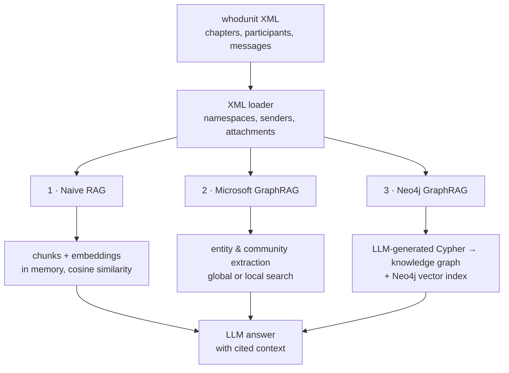

# AI XML Story Investigator

Solve a murder mystery by asking questions about it. The story is a chain of SMS messages between suspects, stored as namespaced XML and split into chapters. The project implements **three Retrieval-Augmented Generation strategies side by side** over the same data, so you can compare how each one handles investigative questions such as *"Who had a motive?"* or *"Which messages contradict each other?"*

There is also a **web UI** (`streamlit_app.py`) that asks the same question to Naive RAG and to Microsoft GraphRAG's global and local search side by side, powered by Google Gemini.

**What the comparison shows:** asked *"Who is responsible for what happened to Liam, and what is the evidence?"*, Naive RAG followed the three most similar chunks to a red herring, while both GraphRAG searches named the right person and walked through the chain of evidence, because their answers draw on relationships across the whole story rather than on isolated chunks.

## The three strategies



| | Naive RAG | Microsoft GraphRAG | Neo4j GraphRAG |
|---|---|---|---|
| **Storage** | In memory | Parquet + LanceDB workspace (`graphrag_index/`, committed) | Neo4j database |
| **Indexing** | Overlapping text chunks → `gemini-embedding-001` (or OpenAI `text-embedding-3-small`) | `graphrag index`: entities, relationships, community reports | LLM extracts entities as Cypher `MERGE` statements; chunks stored as embedded `Document` nodes |
| **Retrieval** | Top-k cosine similarity | **Global** (community summaries) or **local** (entity neighbourhood) search | `VectorRetriever` over the Neo4j vector index |
| **Good at** | Fast, cheap, specific facts | Story-wide questions ("what is going on overall?") | Persisted, queryable graph of people and events |
| **Trade-off** | Loses relationships between distant messages | Slow and expensive indexing | Needs a database and careful prompt design |

## Getting started

**Requirements:** Python 3.10–3.12 (required by graphrag), a [Gemini](https://aistudio.google.com/apikey) API key (or an OpenAI key for strategies 1 and 3), and for strategy 3 an OpenAI key plus a Neo4j instance (a free [Neo4j AuraDB](https://neo4j.com/cloud/aura-free/) works).

```bash
git clone https://github.com/OfekZagury/AI-xml-Story-Investigator.git
cd AI-xml-Story-Investigator
python -m venv .venv
source .venv/bin/activate          # Windows: .venv\Scripts\activate
pip install -r requirements.txt
cp .env.example .env               # add your keys
```

The story (`whodunit_sydney.xml`) is included. Run the command-line version:

```bash
python main.py
```

Pick a strategy (1–3) and start asking questions; type `exit` to quit. Strategy 2 uses the index committed in `graphrag_index/`, so answer `n` when it asks whether to run indexing, then choose global or local search.

Or start the web UI, which compares strategies 1 and 2 side by side:

```bash
streamlit run streamlit_app.py
```

### Rebuilding the GraphRAG index

The index in `graphrag_index/` was built with Gemini (`gemini-3.8-flash` for extraction and community reports, `gemini-embedding-001` for vectors; queries use `gemini-3.5-flash-lite`). To rebuild it after changing the story or `graphrag_index/settings.yaml`:

```bash
python build_graphrag_index.py
```

It takes about five minutes and a few cents of API usage.

### Deploying the web UI

The web UI runs on [Streamlit Community Cloud](https://share.streamlit.io) for free: *Create app* → this repository, branch `master`, main file `streamlit_app.py`; under *Advanced settings* pick Python 3.11 and add the secret `GEMINI_API_KEY = "..."`. To keep API costs predictable, each visitor can ask 10 questions per session, the app answers at most 100 questions a day, and identical questions are answered from a shared cache.

### XML format

```xml
<story xmlns="urn:whodunit:sms:1">
  <participants>
    <person id="p1" name="..." role="..."/>
    <group id="g1" name="..."/>
  </participants>
  <chapter id="c1" title="...">
    <message id="m1" ts="2024-05-01T21:14:00">
      <sender ref="p1"/><receiver ref="g1"/>
      <body>...</body>
      <attachment type="image" file="..." exif="..."/>   <!-- optional -->
    </message>
  </chapter>
</story>
```

## Tests

```bash
python -m unittest discover -s tests -t .
```

## Project structure

```
main.py                     # CLI: load data, choose strategy, Q&A loop
streamlit_app.py            # web UI: compare the strategies side by side
build_graphrag_index.py     # rebuilds graphrag_index/ from the story
whodunit_sydney.xml         # the story
graphrag_index/             # Microsoft GraphRAG settings, prompts and the built index
rag_implementations/
├── naive_rag.py
├── msft_graphrag.py        # graphrag CLI wrapper + in-process query API
└── neo4j_graphrag.py
utils/
├── data_loader.py          # namespaced XML parser
├── story_text.py           # chapter text shared by all strategies (incl. attachment metadata)
└── llm_client.py           # Gemini / OpenAI client with a 3,000-character input guard
tests/
└── test_data_loader.py
```
