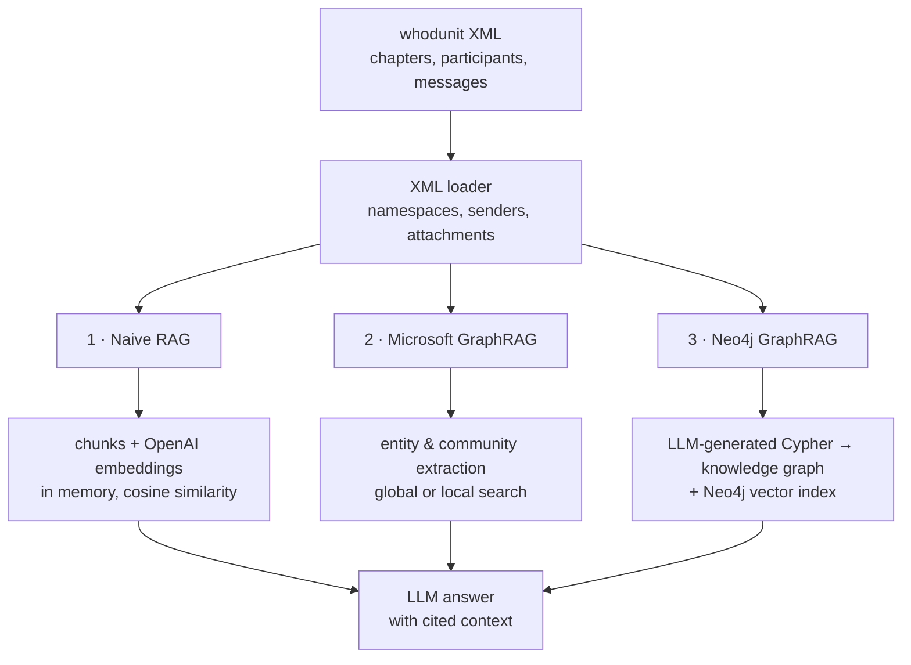

# AI XML Story Investigator

Solve a murder mystery by asking questions about it. The story is a chain of SMS messages between suspects, stored as namespaced XML and split into chapters. The project implements **three Retrieval-Augmented Generation strategies side by side** over the same data, so you can compare how each one handles investigative questions such as *"Who had a motive?"* or *"Which messages contradict each other?"*

<!-- TODO: add a short terminal recording, and a results table comparing the three strategies on the same questions (answer quality, indexing time, cost) -->

## The three strategies



| | Naive RAG | Microsoft GraphRAG | Neo4j GraphRAG |
|---|---|---|---|
| **Storage** | In memory | Local parquet workspace | Neo4j database |
| **Indexing** | Overlapping text chunks → `text-embedding-3-small` | `graphrag index`: entities, relationships, community reports | LLM extracts entities as Cypher `MERGE` statements; chunks stored as embedded `Document` nodes |
| **Retrieval** | Top-k cosine similarity | **Global** (community summaries) or **local** (entity neighbourhood) search | `VectorRetriever` over the Neo4j vector index |
| **Good at** | Fast, cheap, specific facts | Story-wide questions ("what is going on overall?") | Persisted, queryable graph of people and events |
| **Trade-off** | Loses relationships between distant messages | Slow and expensive indexing | Needs a database and careful prompt design |

## Getting started

**Requirements:** Python 3.10–3.12 (required by graphrag), an OpenAI API key, and for strategy 3 a Neo4j instance (a free [Neo4j AuraDB](https://neo4j.com/cloud/aura-free/) works).

```bash
git clone https://github.com/OfekZagury/AI-xml-Story-Investigator.git
cd AI-xml-Story-Investigator
python -m venv .venv
source .venv/bin/activate          # Windows: .venv\Scripts\activate
pip install -r requirements.txt
cp .env.example .env               # add your keys
```

Place the story file as `whodunit_sydney.xml` in the project root, then run:

```bash
python main.py
```

Pick a strategy (1–3) and start asking questions; type `exit` to quit. Strategy 2 asks whether to run indexing (required on the first run) and whether to use global or local search.

### XML format

```xml
<story xmlns="urn:whodunit:sms:1">
  <participants>
    <person id="p1" name="..." role="..."/>
    <group id="g1" name="..."/>
  </participants>
  <chapter id="c1" title="...">
    <message id="m1" ts="2024-05-01T21:14:00">
      <sender ref="p1"/><receiver ref="g1"/>
      <body>...</body>
      <attachment type="image" file="..." exif="..."/>   <!-- optional -->
    </message>
  </chapter>
</story>
```

## Tests

```bash
python -m unittest discover -s tests -t .
```

## Project structure

```
main.py                     # CLI: load data, choose strategy, Q&A loop
rag_implementations/
├── naive_rag.py
├── msft_graphrag.py        # wrapper around the graphrag CLI
└── neo4j_graphrag.py
utils/
├── data_loader.py          # namespaced XML parser
└── llm_client.py           # OpenAI wrapper with a 3,000-character input guard
tests/
└── test_data_loader.py
```
